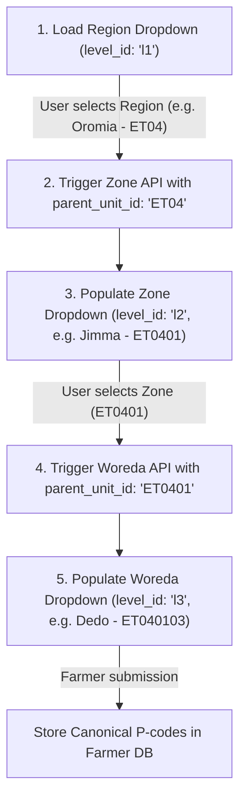

# Farmer Registry — Master Data Service (MDS) Integration Guide
**Technical Specification & API Reference for Farmer Enrollment, Land Holdings & Geolocation**

---

## 1. Scope & Objective

The **Farmer Registry** is responsible for registering individual smallholders, commercial farmers, pastoralists, and agricultural holdings across Ethiopia. To ensure data standardization across government systems, the Farmer Registry must NOT maintain independent, hardcoded lists for administrative boundaries or farming practices.

This guide provides the complete specification of authenticated APIs that the **Farmer Registry** calls against MDS to:
1. **Power Cascading Geolocation Dropdowns**: Region (Level 1) $\rightarrow$ Zone (Level 2) $\rightarrow$ Woreda (Level 3) $\rightarrow$ Kebele (Level 4).
2. **Resolve Geographic Identifiers**: Convert selected names into canonical **P-codes** (e.g., `ET04` for Oromia) with full ancestry paths.
3. **Populate Farm Characteristics**: Agro-ecological zones (`Kolla`, `Weyna Dega`, `Dega`) and land preparation methods.
4. **Validate Farmer Location & Reference Codes**: Verify submitted codes at ingestion time.

---

## 2. Server & Authentication Configuration

All requests to MDS require an authenticated Bearer token from Keycloak.

| Setting | Value |
|---|---|
| **API Base URL** | `https://master-data.development.oanstaging.com` |
| **Keycloak URL** | `https://keycloak.development.oanstaging.com` |
| **Realm** | `staff` |
| **Client ID** | `admin-cli` (or registered client `farmer-registry-staff-portal`) |
| **Protocol** | HTTP `POST` with standard OpenG2P envelope |
| **Required Headers** | `Content-Type: application/json`<br>`Authorization: Bearer <KEYCLOAK_ACCESS_TOKEN>` |

---

## 3. Geolocation Dropdown Cascading Workflow

When an enumerator or staff agent registers a farmer, the UI presents dependent administrative dropdowns:



---

## 4. Geolocation API Endpoints

### API 1.1: Fetch All Administrative Regions (Level 1 Dropdown)

Populates the initial **Region** dropdown (14 National Regional States and 2 Chartered Cities).

- **Endpoint**: `POST /catalogue/get_geo_units`
- **Method**: `POST`
- **Headers**:
  - `Content-Type: application/json`
  - `Authorization: Bearer <KEYCLOAK_ACCESS_TOKEN>`

#### Request Payload:
```json
{
  "request_header": {
    "sender_app_mnemonic": "farmer-registry-staff-portal",
    "sender_app_url": "https://farmer-registry.oanstaging.com",
    "request_id": "{{$guid}}",
    "request_timestamp": "{{$isoTimestamp}}"
  },
  "request_body": {
    "pagination_request": {
      "current_page": 1,
      "page_size": 50
    },
    "request_payload": {
      "level_id": "l1",
      "version": "latest",
      "include_retired": false
    }
  }
}
```

#### JSON Response:
```json
{
  "response_header": {
    "response_status": "SUCCESS"
  },
  "response_body": {
    "pagination_response": {
      "total_records": 15
    },
    "response_payload": {
      "level_id": "l1",
      "units": [
        {
          "unit_id": "ET01",
          "name": "Tigray",
          "pcode": "ET01",
          "level_id": "l1",
          "parent_unit_id": "ETH",
          "status": "ACTIVE"
        },
        {
          "unit_id": "ET03",
          "name": "Amhara",
          "pcode": "ET03",
          "level_id": "l1",
          "parent_unit_id": "ETH",
          "status": "ACTIVE"
        },
        {
          "unit_id": "ET04",
          "name": "Oromia",
          "pcode": "ET04",
          "level_id": "l1",
          "parent_unit_id": "ETH",
          "status": "ACTIVE"
        },
        {
          "unit_id": "ET14",
          "name": "Addis Ababa",
          "pcode": "ET14",
          "level_id": "l1",
          "parent_unit_id": "ETH",
          "status": "ACTIVE"
        }
      ]
    }
  }
}
```

---

### API 1.2: Fetch Zones for Selected Region (Level 2 Dropdown - Cascading)

When the user selects **Oromia** (`unit_id: "ET04"`), the frontend triggers this API passing `parent_unit_id: "ET04"` to fetch only the zones under Oromia.

- **Endpoint**: `POST /catalogue/get_geo_units`
- **Method**: `POST`

#### Request Payload:
```json
{
  "request_header": {
    "sender_app_mnemonic": "farmer-registry-staff-portal",
    "sender_app_url": "https://farmer-registry.oanstaging.com",
    "request_id": "{{$guid}}",
    "request_timestamp": "{{$isoTimestamp}}"
  },
  "request_body": {
    "pagination_request": {
      "current_page": 1,
      "page_size": 100
    },
    "request_payload": {
      "level_id": "l2",
      "parent_unit_id": "ET04",
      "include_retired": false
    }
  }
}
```

#### JSON Response:
```json
{
  "response_header": {
    "response_status": "SUCCESS"
  },
  "response_body": {
    "pagination_response": {
      "total_records": 21
    },
    "response_payload": {
      "level_id": "l2",
      "units": [
        {
          "unit_id": "ET0401",
          "pcode": "ET0401",
          "name": "Jimma",
          "parent_unit_id": "ET04",
          "level_id": "l2",
          "status": "ACTIVE"
        },
        {
          "unit_id": "ET0402",
          "pcode": "ET0402",
          "name": "East Shewa",
          "parent_unit_id": "ET04",
          "level_id": "l2",
          "status": "ACTIVE"
        },
        {
          "unit_id": "ET0403",
          "pcode": "ET0403",
          "name": "West Arsi",
          "parent_unit_id": "ET04",
          "level_id": "l2",
          "status": "ACTIVE"
        }
      ]
    }
  }
}
```

---

### API 1.3: Fetch Woredas for Selected Zone (Level 3 Dropdown - Cascading)

When the user selects **Jimma Zone** (`unit_id: "ET0401"`), the frontend triggers this API to fetch all woredas inside Jimma Zone.

- **Endpoint**: `POST /catalogue/get_geo_units`
- **Method**: `POST`

#### Request Payload:
```json
{
  "request_header": {
    "sender_app_mnemonic": "farmer-registry-staff-portal",
    "sender_app_url": "https://farmer-registry.oanstaging.com",
    "request_id": "{{$guid}}",
    "request_timestamp": "{{$isoTimestamp}}"
  },
  "request_body": {
    "pagination_request": {
      "current_page": 1,
      "page_size": 100
    },
    "request_payload": {
      "level_id": "l3",
      "parent_unit_id": "ET0401",
      "include_retired": false
    }
  }
}
```

#### JSON Response:
```json
{
  "response_header": {
    "response_status": "SUCCESS"
  },
  "response_body": {
    "pagination_response": {
      "total_records": 21
    },
    "response_payload": {
      "level_id": "l3",
      "units": [
        {
          "unit_id": "ET040101",
          "pcode": "ET040101",
          "name": "Agaro",
          "parent_unit_id": "ET0401",
          "level_id": "l3",
          "status": "ACTIVE"
        },
        {
          "unit_id": "ET040102",
          "pcode": "ET040102",
          "name": "Chora Botor",
          "parent_unit_id": "ET0401",
          "level_id": "l3",
          "status": "ACTIVE"
        },
        {
          "unit_id": "ET040103",
          "pcode": "ET040103",
          "name": "Dedo",
          "parent_unit_id": "ET0401",
          "level_id": "l3",
          "status": "ACTIVE"
        }
      ]
    }
  }
}
```

---

### API 1.4: Resolve a Single Unit by P-code & Retrieve Hierarchy Ancestors

When rendering an existing farmer profile, the Farmer Registry has stored P-codes (e.g. `woreda_pcode: "ET040103"`). To resolve the full human-readable hierarchy path without making multiple calls, use `get_geo_unit`.

- **Endpoint**: `POST /catalogue/get_geo_unit`
- **Method**: `POST`

#### Request Payload:
```json
{
  "request_header": {
    "sender_app_mnemonic": "farmer-registry-staff-portal",
    "sender_app_url": "https://farmer-registry.oanstaging.com",
    "request_id": "{{$guid}}",
    "request_timestamp": "{{$isoTimestamp}}"
  },
  "request_body": {
    "request_payload": {
      "unit_id": "ET040103"
    }
  }
}
```

#### JSON Response:
```json
{
  "response_header": {
    "response_status": "SUCCESS"
  },
  "response_body": {
    "response_payload": {
      "unit": {
        "unit_id": "ET040103",
        "pcode": "ET040103",
        "name": "Dedo",
        "level_id": "l3",
        "parent_unit_id": "ET0401",
        "ancestors": [
          { "level_id": "l0", "unit_id": "country-ETH", "name": "Ethiopia", "pcode": "ETH" },
          { "level_id": "l1", "unit_id": "ET04", "name": "Oromia", "pcode": "ET04" },
          { "level_id": "l2", "unit_id": "ET0401", "name": "Jimma", "pcode": "ET0401" }
        ]
      }
    }
  }
}
```

---

## 5. Farm Land Characteristics Catalogs

In addition to geolocation, the Farmer Registry captures plot altitude/agro-ecology and primary land preparation techniques.

### API 2.1: Fetch Agro-Ecological Zones (`ECOLOGICAL_ZONE_CATALOG`)

Populates the agro-ecological altitude zone of the farmer's landholding.

- **Endpoint**: `POST /catalogue/get_list_values`
- **Method**: `POST`

#### Request Payload:
```json
{
  "request_header": {
    "sender_app_mnemonic": "farmer-registry-staff-portal",
    "request_id": "{{$guid}}",
    "request_timestamp": "{{$isoTimestamp}}"
  },
  "request_body": {
    "pagination_request": { "current_page": 1, "page_size": 20 },
    "request_payload": {
      "list_code": "ECOLOGICAL_ZONE_CATALOG",
      "version": "latest",
      "include_retired": false
    }
  }
}
```

#### JSON Response:
```json
{
  "response_header": {
    "response_status": "SUCCESS"
  },
  "response_body": {
    "response_payload": {
      "list_code": "ECOLOGICAL_ZONE_CATALOG",
      "values": [
        {
          "value_code": "ZONE_1",
          "display": "Kolla (Lowland)",
          "status": "ACTIVE",
          "attributes": {
            "zone_id": 1,
            "altitude_range": "Below 1,500m above sea level; warm/semi-arid climate"
          }
        },
        {
          "value_code": "ZONE_2",
          "display": "Weyna Dega (Midland)",
          "status": "ACTIVE",
          "attributes": {
            "zone_id": 2,
            "altitude_range": "1,500m - 2,300m above sea level; temperate main cropping zone"
          }
        },
        {
          "value_code": "ZONE_3",
          "display": "Dega (Highland)",
          "status": "ACTIVE",
          "attributes": {
            "zone_id": 3,
            "altitude_range": "Above 2,300m above sea level; cool highland climate (Barley, Wheat, Potato)"
          }
        }
      ]
    }
  }
}
```

---

### API 2.2: Fetch Land Preparation Methods (`LAND_PREPARATION_METHOD_CATALOG`)

Populates the tillage method dropdown when registering farmer parcels.

- **Endpoint**: `POST /catalogue/get_list_values`
- **Method**: `POST`

#### Request Payload:
```json
{
  "request_header": {
    "sender_app_mnemonic": "farmer-registry-staff-portal",
    "request_id": "{{$guid}}",
    "request_timestamp": "{{$isoTimestamp}}"
  },
  "request_body": {
    "pagination_request": { "current_page": 1, "page_size": 20 },
    "request_payload": {
      "list_code": "LAND_PREPARATION_METHOD_CATALOG",
      "version": "latest",
      "include_retired": false
    }
  }
}
```

#### JSON Response:
```json
{
  "response_header": { "response_status": "SUCCESS" },
  "response_body": {
    "response_payload": {
      "list_code": "LAND_PREPARATION_METHOD_CATALOG",
      "values": [
        { "value_code": "LPM_OXEN", "display": "Oxen plough (Traditional Maresha)", "sort_order": 1, "status": "ACTIVE" },
        { "value_code": "LPM_TRACTOR", "display": "Mechanized Tractor", "sort_order": 2, "status": "ACTIVE" },
        { "value_code": "LPM_MANUAL", "display": "Manual tillage (Hoe / Hand tools)", "sort_order": 3, "status": "ACTIVE" },
        { "value_code": "LPM_ZERO_TILLAGE", "display": "Zero Tillage / Conservation Agriculture", "sort_order": 4, "status": "ACTIVE" }
      ]
    }
  }
}
```

---

## 6. Frontend Code Example (React Cascading Dropdown with Core API)

Below is an executable React snippet demonstrating how the Farmer Registry frontend calls the authenticated MDS API via the registry backend:

```tsx
import React, { useState, useEffect } from 'react';

const MDS_API_URL = 'https://master-data.development.oanstaging.com/catalogue/get_geo_units';

// Helper to construct standard OpenG2P envelope
const createG2PEnvelope = (payload) => ({
  request_header: {
    sender_app_mnemonic: 'farmer-registry-staff-portal',
    sender_app_url: window.location.origin,
    request_id: crypto.randomUUID(),
    request_timestamp: new Date().toISOString()
  },
  request_body: {
    pagination_request: { current_page: 1, page_size: 100 },
    request_payload: payload
  }
});

export const FarmerLocationSelector = ({ token, onLocationChange }) => {
  const [regions, setRegions] = useState([]);
  const [zones, setZones] = useState([]);
  const [woredas, setWoredas] = useState([]);

  const [selectedRegion, setSelectedRegion] = useState('');
  const [selectedZone, setSelectedZone] = useState('');
  const [selectedWoreda, setSelectedWoreda] = useState('');

  const headers = {
    'Content-Type': 'application/json',
    'Authorization': `Bearer ${token}`
  };

  // 1. Fetch Regions on mount (level_id: 'l1')
  useEffect(() => {
    fetch(MDS_API_URL, {
      method: 'POST',
      headers,
      body: JSON.stringify(createG2PEnvelope({ level_id: 'l1' }))
    })
      .then(res => res.json())
      .then(data => setRegions(data?.response_body?.response_payload?.units || []));
  }, [token]);

  // 2. Fetch Zones when Region changes (level_id: 'l2', parent_unit_id: region)
  const handleRegionChange = (regionId) => {
    setSelectedRegion(regionId);
    setSelectedZone('');
    setSelectedWoreda('');
    setZones([]);
    setWoredas([]);

    if (regionId) {
      fetch(MDS_API_URL, {
        method: 'POST',
        headers,
        body: JSON.stringify(createG2PEnvelope({ level_id: 'l2', parent_unit_id: regionId }))
      })
        .then(res => res.json())
        .then(data => setZones(data?.response_body?.response_payload?.units || []));
    }
  };

  // 3. Fetch Woredas when Zone changes (level_id: 'l3', parent_unit_id: zone)
  const handleZoneChange = (zoneId) => {
    setSelectedZone(zoneId);
    setSelectedWoreda('');
    setWoredas([]);

    if (zoneId) {
      fetch(MDS_API_URL, {
        method: 'POST',
        headers,
        body: JSON.stringify(createG2PEnvelope({ level_id: 'l3', parent_unit_id: zoneId }))
      })
        .then(res => res.json())
        .then(data => setWoredas(data?.response_body?.response_payload?.units || []));
    }
  };

  const handleWoredaChange = (woredaId) => {
    setSelectedWoreda(woredaId);
    if (onLocationChange) {
      onLocationChange({
        region_pcode: selectedRegion,
        zone_pcode: selectedZone,
        woreda_pcode: woredaId
      });
    }
  };

  return (
    <div className="location-selector-grid">
      <div>
        <label>Region *</label>
        <select value={selectedRegion} onChange={(e) => handleRegionChange(e.target.value)}>
          <option value="">Select Region</option>
          {regions.map(r => (
            <option key={r.unit_id} value={r.unit_id}>{r.name} ({r.pcode})</option>
          ))}
        </select>
      </div>

      <div>
        <label>Zone *</label>
        <select 
          value={selectedZone} 
          onChange={(e) => handleZoneChange(e.target.value)}
          disabled={!selectedRegion || zones.length === 0}
        >
          <option value="">Select Zone</option>
          {zones.map(z => (
            <option key={z.unit_id} value={z.unit_id}>{z.name} ({z.pcode})</option>
          ))}
        </select>
      </div>

      <div>
        <label>Woreda / District *</label>
        <select 
          value={selectedWoreda} 
          onChange={(e) => handleWoredaChange(e.target.value)}
          disabled={!selectedZone || woredas.length === 0}
        >
          <option value="">Select Woreda</option>
          {woredas.map(w => (
            <option key={w.unit_id} value={w.unit_id}>{w.name} ({w.pcode})</option>
          ))}
        </select>
      </div>
    </div>
  );
};
```

---

## 7. Submission Validation Checklist for Farmer Registry

When a farmer record is submitted to the Farmer Registry backend, the registry MUST validate that:
- [ ] `region_pcode`: Exists in MDS Level 1 geography and status is `ACTIVE`.
- [ ] `zone_pcode`: Exists in Level 2 geography, is `ACTIVE`, and has `parent_unit_id == submitted region_pcode`.
- [ ] `woreda_pcode`: Exists in Level 3 geography, is `ACTIVE`, and has `parent_unit_id == submitted zone_pcode`.
- [ ] `ecological_zone`: Matches one of `ZONE_1`, `ZONE_2`, or `ZONE_3` from `ECOLOGICAL_ZONE_CATALOG`.
- [ ] `land_preparation_method`: Matches an active key in `LAND_PREPARATION_METHOD_CATALOG`.
