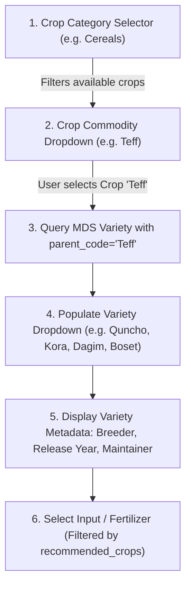

# Crop Sown Registry — Master Data Service (MDS) Integration Guide
**Technical Specification & API Reference for Crop Declarations, Varieties, Certified Seeds & Inputs**

---

## 1. Scope & Objective

The **Crop Sown Registry** captures seasonal planting declarations from farmers and agricultural enterprises across Ethiopia. It records what crops were planted, the registered seed varieties utilized, the acreage sown, the agro-ecological conditions of the plot, and the agricultural inputs (fertilizers, chemicals, soil amendments) applied.

To maintain national statistical consistency and ensure subsidy traceability, the Crop Sown Registry dynamically fetches and validates all reference data from **Master Data Service (MDS)**.

This guide provides technical specifications for:
1. **Cascading Crop Selection**: Crop Category $\rightarrow$ Crop Commodity $\rightarrow$ Certified Variety.
2. **Certified Seed Master Data & Demand Classes**: Breeder, Basic, Certified C1/C2.
3. **Approved Agricultural Inputs**: Certified fertilizers (NPSB, Urea, DAP), bio-inoculants, and pesticides with approved dosages.
4. **Agro-Ecological Plot Context**: Altitude zone validation.

---

## 2. Server & Authentication Configuration

All requests to MDS require an authenticated Bearer token from Keycloak.

| Setting | Value |
|---|---|
| **API Base URL** | `https://master-data.development.oanstaging.com` |
| **Keycloak URL** | `https://keycloak.development.oanstaging.com` |
| **Realm** | `staff` |
| **Client ID** | `admin-cli` (or registered client `farmer-registry-staff-portal`) |
| **Protocol** | HTTP `POST` with standard OpenG2P envelope |
| **Required Headers** | `Content-Type: application/json`<br>`Authorization: Bearer <KEYCLOAK_ACCESS_TOKEN>` |

---

## 3. Crop & Variety Cascading Architecture

When an enumerator or agricultural extension worker logs a sowing event, the UI presents dependent selectors:



---

## 4. Crop Declarations API Endpoints

### API 1.1: Fetch Crop Categories (`CROP_CATEGORY_CATALOG`)

Populates the top-level crop classification (Cereals, Pulses, Oilseeds, Vegetables, Fruits, Cash Crops, Root/Tuber Crops).

- **Endpoint**: `POST /catalogue/get_list_values`
- **Method**: `POST`
- **Headers**:
  - `Content-Type: application/json`
  - `Authorization: Bearer <KEYCLOAK_ACCESS_TOKEN>`

#### Request Payload:
```json
{
  "request_header": {
    "sender_app_mnemonic": "crop-sown-registry",
    "sender_app_url": "https://crop-registry.oanstaging.com",
    "request_id": "{{$guid}}",
    "request_timestamp": "{{$isoTimestamp}}"
  },
  "request_body": {
    "pagination_request": {
      "current_page": 1,
      "page_size": 20
    },
    "request_payload": {
      "list_code": "CROP_CATEGORY_CATALOG",
      "version": "latest",
      "include_retired": false
    }
  }
}
```

#### JSON Response:
```json
{
  "response_header": {
    "response_status": "SUCCESS"
  },
  "response_body": {
    "pagination_response": {
      "total_records": 7
    },
    "response_payload": {
      "list_code": "CROP_CATEGORY_CATALOG",
      "values": [
        {
          "value_code": "Cereals",
          "display": "Cereals",
          "status": "ACTIVE",
          "attributes": {
            "category_id": 1,
            "description": "Grains cultivated for edible components (Teff, Wheat, Maize, Barley, Sorghum, Millet)"
          }
        },
        {
          "value_code": "Pulses",
          "display": "Pulses",
          "status": "ACTIVE",
          "attributes": {
            "category_id": 2,
            "description": "Grain legumes harvested for dry grains (Faba Bean, Chickpea, Lentil, Field Pea, Haricot Bean)"
          }
        },
        {
          "value_code": "Oilseeds",
          "display": "Oilseeds",
          "status": "ACTIVE",
          "attributes": {
            "category_id": 3,
            "description": "Crops grown primarily for oil extraction (Sesame, Niger Seed / Noug, Linseed, Groundnut)"
          }
        }
      ]
    }
  }
}
```

---

### API 1.2: Fetch Crop Commodities (`CROP_CATALOG`)

Retrieves the national catalog of 129 registered crop species with their agro-ecological requirements and inspection rules.

- **Endpoint**: `POST /catalogue/get_list_values`
- **Method**: `POST`

#### Request Payload (with optional category filter):
```json
{
  "request_header": {
    "sender_app_mnemonic": "crop-sown-registry",
    "sender_app_url": "https://crop-registry.oanstaging.com",
    "request_id": "{{$guid}}",
    "request_timestamp": "{{$isoTimestamp}}"
  },
  "request_body": {
    "pagination_request": {
      "current_page": 1,
      "page_size": 150
    },
    "request_payload": {
      "list_code": "CROP_CATALOG",
      "version": "latest",
      "include_retired": false,
      "attribute_filters": {
        "category": "Cereals"
      }
    }
  }
}
```

#### JSON Response:
```json
{
  "response_header": {
    "response_status": "SUCCESS"
  },
  "response_body": {
    "pagination_response": {
      "total_records": 129
    },
    "response_payload": {
      "list_code": "CROP_CATALOG",
      "version_no": 1,
      "values": [
        {
          "value_id": "1",
          "value_code": "1",
          "display": "Teff",
          "status": "ACTIVE",
          "attributes": {
            "category": "Cereals",
            "category_id": 1,
            "ecological_zone": "Weyna Dega (Midland)",
            "ecological_zone_id": 2,
            "known_for": "Staple Ethiopian grain, gluten-free, resilient to waterlogging",
            "isolation_distance_meters": 3,
            "num_field_inspection_needed": 2
          }
        },
        {
          "value_id": "2",
          "value_code": "2",
          "display": "Bread Wheat",
          "status": "ACTIVE",
          "attributes": {
            "category": "Cereals",
            "category_id": 1,
            "ecological_zone": "Dega (Highland)",
            "ecological_zone_id": 3,
            "known_for": "High gluten flour for injera and bread making",
            "isolation_distance_meters": 3,
            "num_field_inspection_needed": 3
          }
        },
        {
          "value_id": "3",
          "value_code": "3",
          "display": "Maize",
          "status": "ACTIVE",
          "attributes": {
            "category": "Cereals",
            "category_id": 1,
            "ecological_zone": "Kolla (Lowland) & Weyna Dega",
            "ecological_zone_id": 1,
            "known_for": "High-yielding staple calorie crop",
            "isolation_distance_meters": 200,
            "num_field_inspection_needed": 3
          }
        }
      ]
    }
  }
}
```

---

### API 1.3: Fetch Registered Varieties for Selected Crop (Level 3 Cascading)

When the user selects **Teff** (or **Bread Wheat**), the frontend queries the **Crop Variety Catalog** (902 total entries) passing `parent_code="Teff"` to receive only certified varieties for that crop.

- **Endpoint**: `POST /catalogue/get_list_values`
- **Method**: `POST`

#### Request Payload:
```json
{
  "request_header": {
    "sender_app_mnemonic": "crop-sown-registry",
    "sender_app_url": "https://crop-registry.oanstaging.com",
    "request_id": "{{$guid}}",
    "request_timestamp": "{{$isoTimestamp}}"
  },
  "request_body": {
    "pagination_request": {
      "current_page": 1,
      "page_size": 100
    },
    "request_payload": {
      "list_code": "CROP_VARIETY_CATALOG",
      "parent_code": "Teff",
      "version": "latest",
      "include_retired": false
    }
  }
}
```

#### JSON Response:
```json
{
  "response_header": {
    "response_status": "SUCCESS"
  },
  "response_body": {
    "pagination_response": {
      "total_records": 38
    },
    "response_payload": {
      "list_code": "CROP_VARIETY_CATALOG",
      "values": [
        {
          "value_id": "VARIETY_101",
          "value_code": "Quncho (DZ-Cr-387)",
          "display": "Quncho",
          "parent_value_code": "Teff",
          "status": "ACTIVE",
          "attributes": {
            "crop_id": 1,
            "crop_name": "Teff",
            "release_year": 2006,
            "release_date": "2006-05-15",
            "maintainer": "Debre Zeit Agricultural Research Center (DZARC / EIAR)",
            "source": "DZ-01-974 x DZ-01-196",
            "details_url": "https://ethioseed.gov.et/varieties/quncho"
          }
        },
        {
          "value_id": "VARIETY_102",
          "value_code": "Kora (DZ-Cr-438)",
          "display": "Kora",
          "parent_value_code": "Teff",
          "status": "ACTIVE",
          "attributes": {
            "crop_id": 1,
            "crop_name": "Teff",
            "release_year": 2014,
            "release_date": "2014-06-20",
            "maintainer": "Debre Zeit Agricultural Research Center (DZARC)",
            "source": "Pedigree Selection"
          }
        },
        {
          "value_id": "VARIETY_103",
          "value_code": "Dagim (DZ-Cr-453)",
          "display": "Dagim",
          "parent_value_code": "Teff",
          "status": "ACTIVE",
          "attributes": {
            "crop_id": 1,
            "crop_name": "Teff",
            "release_year": 2018,
            "release_date": "2018-04-12",
            "maintainer": "EIAR - Debre Zeit",
            "source": "Pureline selection"
          }
        }
      ]
    }
  }
}
```

---

## 5. Agricultural Inputs & Fertilizer Master Data

The **Crop Sown Registry** captures fertilizer applications, bio-inoculant treatments, and pest management sprays to assess input usage and subsidy distribution.

### API 2.1: Fetch Approved Agricultural Inputs (`INPUT_CATALOG`)

Retrieves the official Ministry of Agriculture reference catalog of 11 approved fertilizers, chemical pesticides, and soil amendments.

- **Endpoint**: `POST /catalogue/get_list_values`
- **Method**: `POST`

#### Request Payload:
```json
{
  "request_header": {
    "sender_app_mnemonic": "crop-sown-registry",
    "sender_app_url": "https://crop-registry.oanstaging.com",
    "request_id": "{{$guid}}",
    "request_timestamp": "{{$isoTimestamp}}"
  },
  "request_body": {
    "pagination_request": {
      "current_page": 1,
      "page_size": 20
    },
    "request_payload": {
      "list_code": "INPUT_CATALOG",
      "version": "latest",
      "include_retired": false,
      "attribute_filters": {
        "input_category": "INORGANIC_FERTILIZER"
      }
    }
  }
}
```

#### JSON Response:
```json
{
  "response_header": {
    "response_status": "SUCCESS"
  },
  "response_body": {
    "pagination_response": {
      "total_records": 11
    },
    "response_payload": {
      "list_code": "INPUT_CATALOG",
      "values": [
        {
          "value_id": "FERT-NPSB",
          "value_code": "FERT-NPSB",
          "display": "NPSB Soil Blend",
          "status": "ACTIVE",
          "attributes": {
            "input_code": "FERT-NPSB",
            "trade_name": "NPSB Soil Blend",
            "input_category": "INORGANIC_FERTILIZER",
            "nutrient_composition": "18.9% N, 37.7% P2O5, 6.95% S, 0.1% B",
            "manufacturer": "OCP Group / Ministry of Agriculture",
            "application_method": "Basal row application at planting",
            "recommended_crops": "Wheat, Teff, Barley, Maize",
            "recommended_dosage": "100 kg/ha",
            "license_number": "MOA-REG-FERT-2021-001",
            "safety_precautions": "Store in dry cool place. Keep away from water sources."
          }
        },
        {
          "value_id": "FERT-UREA",
          "value_code": "FERT-UREA",
          "display": "Urea 46-0-0",
          "status": "ACTIVE",
          "attributes": {
            "input_code": "FERT-UREA",
            "trade_name": "Urea 46-0-0",
            "input_category": "INORGANIC_FERTILIZER",
            "nutrient_composition": "46% Total Nitrogen (N)",
            "manufacturer": "Ethio-Agri Import Corp",
            "application_method": "Split top-dressing at active tillering",
            "recommended_crops": "All Cereals, Horticultural Crops",
            "recommended_dosage": "100 kg/ha",
            "license_number": "MOA-REG-FERT-2021-002"
          }
        },
        {
          "value_id": "FERT-BIO-RHIZO",
          "value_code": "FERT-BIO-RHIZO",
          "display": "Legume Bio-Rhizobium",
          "status": "ACTIVE",
          "attributes": {
            "input_code": "FERT-BIO-RHIZO",
            "trade_name": "Legume Bio-Rhizobium",
            "input_category": "BIO_FERTILIZER",
            "nutrient_composition": "Live Rhizobium leguminosarum strain (> 10^9 CFU/g)",
            "manufacturer": "National Soil Testing Lab / Holetta",
            "application_method": "Seed coating slurry before sowing",
            "recommended_crops": "Faba Bean, Chickpea, Lentils, Soybean",
            "recommended_dosage": "500 g per 50 kg seed",
            "license_number": "MOA-REG-BIO-2021-005"
          }
        },
        {
          "value_id": "AMEND-LIME",
          "value_code": "AMEND-LIME",
          "display": "Agricultural Dolomitic Lime",
          "status": "ACTIVE",
          "attributes": {
            "input_code": "AMEND-LIME",
            "trade_name": "Agricultural Dolomitic Lime",
            "input_category": "SOIL_AMENDMENT",
            "nutrient_composition": "85% CaCO3 + MgCO3, Neutralizing Value 95%",
            "manufacturer": "Ethiopian Mineral Development SC",
            "application_method": "Broadcast and incorporation before rains",
            "recommended_crops": "Acid soils (pH < 5.5) for Barley, Wheat, Teff",
            "recommended_dosage": "2000 - 3000 kg/ha"
          }
        }
      ]
    }
  }
}
```

---

## 6. Frontend Code Example (React Cascading Crop & Variety Selector)

```tsx
import React, { useState, useEffect } from 'react';

const MDS_API_URL = 'https://master-data.development.oanstaging.com/catalogue/get_list_values';

const createG2PEnvelope = (listCode, parentCode = null) => ({
  request_header: {
    sender_app_mnemonic: 'crop-sown-registry',
    sender_app_url: window.location.origin,
    request_id: crypto.randomUUID(),
    request_timestamp: new Date().toISOString()
  },
  request_body: {
    pagination_request: { current_page: 1, page_size: 150 },
    request_payload: {
      list_code: listCode,
      parent_code: parentCode,
      version: 'latest',
      include_retired: false
    }
  }
});

export const CropSownSelector = ({ token, onCropSelected }) => {
  const [crops, setCrops] = useState([]);
  const [varieties, setVarieties] = useState([]);
  const [selectedCrop, setSelectedCrop] = useState('');
  const [selectedVariety, setSelectedVariety] = useState('');
  const [varietyDetails, setVarietyDetails] = useState(null);

  const headers = {
    'Content-Type': 'application/json',
    'Authorization': `Bearer ${token}`
  };

  // 1. Load All Crops on mount
  useEffect(() => {
    fetch(MDS_API_URL, {
      method: 'POST',
      headers,
      body: JSON.stringify(createG2PEnvelope('CROP_CATALOG'))
    })
      .then(res => res.json())
      .then(data => setCrops(data?.response_body?.response_payload?.values || []));
  }, [token]);

  // 2. Fetch Varieties when Crop changes
  const handleCropChange = (cropName) => {
    setSelectedCrop(cropName);
    setSelectedVariety('');
    setVarietyDetails(null);
    setVarieties([]);

    if (cropName) {
      fetch(MDS_API_URL, {
        method: 'POST',
        headers,
        body: JSON.stringify(createG2PEnvelope('CROP_VARIETY_CATALOG', cropName))
      })
        .then(res => res.json())
        .then(data => setVarieties(data?.response_body?.response_payload?.values || []));
    }
  };

  const handleVarietyChange = (varietyCode) => {
    setSelectedVariety(varietyCode);
    const match = varieties.find(v => v.value_code === varietyCode);
    setVarietyDetails(match ? match.attributes : null);

    if (onCropSelected) {
      onCropSelected({
        crop_name: selectedCrop,
        variety_code: varietyCode,
        maintainer: match?.attributes?.maintainer,
        release_year: match?.attributes?.release_year
      });
    }
  };

  return (
    <div className="crop-selector-box">
      <div className="form-group">
        <label>Crop Commodity *</label>
        <select value={selectedCrop} onChange={e => handleCropChange(e.target.value)}>
          <option value="">Select Crop</option>
          {crops.map(c => (
            <option key={c.value_code} value={c.display}>{c.display} ({c.attributes?.category})</option>
          ))}
        </select>
      </div>

      <div className="form-group">
        <label>Certified Variety *</label>
        <select 
          value={selectedVariety} 
          onChange={e => handleVarietyChange(e.target.value)}
          disabled={!selectedCrop || varieties.length === 0}
        >
          <option value="">{varieties.length === 0 ? 'No varieties registered' : 'Select Variety'}</option>
          {varieties.map(v => (
            <option key={v.value_code} value={v.value_code}>{v.display} ({v.attributes?.release_year})</option>
          ))}
        </select>
      </div>

      {varietyDetails && (
        <div className="variety-info-card">
          <p><strong>Maintainer:</strong> {varietyDetails.maintainer}</p>
          <p><strong>Release Year:</strong> {varietyDetails.release_year}</p>
          <p><strong>Pedigree / Source:</strong> {varietyDetails.source}</p>
        </div>
      )}
    </div>
  );
};
```

---

## 7. Validation Rules for Crop Sown Registry

When an entry is submitted, the Crop Sown Registry backend MUST validate via `POST /catalogue/get_list_value`:
- [ ] `crop_code`: Exists and is `ACTIVE` in `CROP_CATALOG`.
- [ ] `variety_code`: Exists in `CROP_VARIETY_CATALOG` with `parent_code == crop_name`.
- [ ] `inputs_applied`: Each input code exists in `INPUT_CATALOG`.
- [ ] `dosage_rate`: Within plausible safety thresholds (e.g. Urea $\le$ 200 kg/ha).
