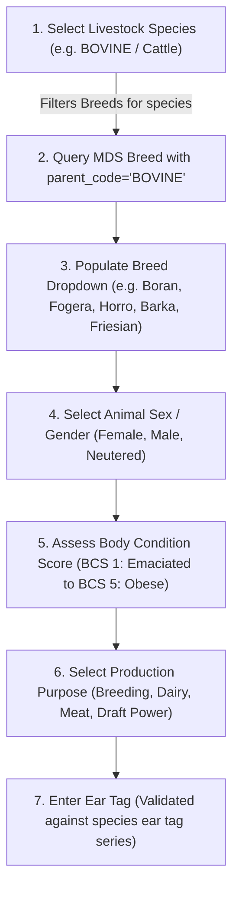

# Livestock Registry (ET-LITS / LIS) — Master Data Service (MDS) Integration Guide
**Technical Specification & API Reference for Animal Identification, Breeds, BCS & Herd Management**

---

## 1. Scope & Objective

The **Livestock Registry** encompasses the **Ethiopia Livestock Identification and Traceability System (ET-LITS)** and the **Livestock Information System (LIS)** governed by the **Livestock Development Institute (LDI)**. It manages:
- Individual ear tag animal identification and pedigree tracing.
- Herd-level health and vaccination registries.
- Breed census, genetic characterization, and artificial insemination records.
- Meat and dairy export compliance standards.

To ensure uniform veterinary and genetic terminology across regional bureaus, research centers, and export abattoirs, the Livestock Registry consumes all species, breed, body condition, and holding classifications from **Master Data Service (MDS)**.

This guide provides technical specifications for:
1. **Cascading Livestock Selection**: Species $\rightarrow$ Registered Breed (Indigenous, Exotic, Cross).
2. **Standard Body Condition Scoring (BCS 1 to 5)**.
3. **Animal Gender & Reproductive Classifications**.
4. **Production Purpose Mappings (Dairy, Meat, Traction, Breeding)**.
5. **Livestock Agro-Ecological Holding Zones**.
6. **Animal Holding Geolocation (Region $\rightarrow$ Zone $\rightarrow$ Woreda)**.

---

## 2. Server & Authentication Configuration

All requests to MDS require an authenticated Bearer token from Keycloak.

| Setting | Value |
|---|---|
| **API Base URL** | `https://master-data.development.oanstaging.com` |
| **Keycloak URL** | `https://keycloak.development.oanstaging.com` |
| **Realm** | `staff` |
| **Client ID** | `admin-cli` (or registered client `farmer-registry-staff-portal`) |
| **Protocol** | HTTP `POST` with standard OpenG2P envelope |
| **Required Headers** | `Content-Type: application/json`<br>`Authorization: Bearer <KEYCLOAK_ACCESS_TOKEN>` |

---

## 3. Livestock Registration Cascading Workflow



---

## 4. Livestock Declarations API Endpoints

### API 1.1: Fetch Livestock Species (`LIVESTOCK_CATALOG`)

Populates the top-level species dropdown (Bovine, Ovine, Caprine, Camel, Equine, Donkey, Poultry).

- **Endpoint**: `POST /catalogue/get_list_values`
- **Method**: `POST`
- **Headers**:
  - `Content-Type: application/json`
  - `Authorization: Bearer <KEYCLOAK_ACCESS_TOKEN>`

#### Request Payload:
```json
{
  "request_header": {
    "sender_app_mnemonic": "livestock-registry-etlits",
    "sender_app_url": "https://etlits.ldi.gov.et",
    "request_id": "{{$guid}}",
    "request_timestamp": "{{$isoTimestamp}}"
  },
  "request_body": {
    "pagination_request": {
      "current_page": 1,
      "page_size": 20
    },
    "request_payload": {
      "list_code": "LIVESTOCK_CATALOG",
      "version": "latest",
      "include_retired": false
    }
  }
}
```

#### JSON Response:
```json
{
  "response_header": {
    "response_status": "SUCCESS"
  },
  "response_body": {
    "pagination_response": {
      "total_records": 6
    },
    "response_payload": {
      "list_code": "LIVESTOCK_CATALOG",
      "version_no": 1,
      "values": [
        {
          "value_id": "BOVINE",
          "value_code": "BOVINE",
          "display": "Cattle (Bovine)",
          "status": "ACTIVE",
          "attributes": {
            "scientific_name": "Bos taurus / Bos indicus",
            "subfamily": "Bovinae",
            "species_type_code": 1,
            "chart_color": "#2563EB",
            "ear_tag_range": "ET-BOV-0000001 - ET-BOV-9999999",
            "in_lis_population": true,
            "in_etlits_registry": true
          }
        },
        {
          "value_id": "OVINE",
          "value_code": "OVINE",
          "display": "Sheep (Ovine)",
          "status": "ACTIVE",
          "attributes": {
            "scientific_name": "Ovis aries",
            "subfamily": "Caprinae",
            "species_type_code": 2,
            "chart_color": "#10B981",
            "ear_tag_range": "ET-OVI-0000001 - ET-OVI-9999999",
            "in_lis_population": true,
            "in_etlits_registry": true
          }
        },
        {
          "value_id": "CAPRINE",
          "value_code": "CAPRINE",
          "display": "Goat (Caprine)",
          "status": "ACTIVE",
          "attributes": {
            "scientific_name": "Capra hircus",
            "subfamily": "Caprinae",
            "species_type_code": 3,
            "chart_color": "#F59E0B",
            "ear_tag_range": "ET-CAP-0000001 - ET-CAP-9999999",
            "in_lis_population": true,
            "in_etlits_registry": true
          }
        },
        {
          "value_id": "CAMEL",
          "value_code": "CAMEL",
          "display": "Camel (Dromedary)",
          "status": "ACTIVE",
          "attributes": {
            "scientific_name": "Camelus dromedarius",
            "subfamily": "Camelinae",
            "species_type_code": 4,
            "ear_tag_range": "ET-CAM-0000001 - ET-CAM-9999999",
            "in_lis_population": true,
            "in_etlits_registry": true
          }
        }
      ]
    }
  }
}
```

---

### API 1.2: Fetch Registered Breeds for Selected Species (`LIVESTOCK_BREED_CATALOG`)

When an enumerator selects **Cattle (`BOVINE`)**, the frontend calls this API passing `parent_code="BOVINE"` to retrieve only the 28 registered cattle breeds.

- **Endpoint**: `POST /catalogue/get_list_values`
- **Method**: `POST`

#### Request Payload:
```json
{
  "request_header": {
    "sender_app_mnemonic": "livestock-registry-etlits",
    "sender_app_url": "https://etlits.ldi.gov.et",
    "request_id": "{{$guid}}",
    "request_timestamp": "{{$isoTimestamp}}"
  },
  "request_body": {
    "pagination_request": {
      "current_page": 1,
      "page_size": 100
    },
    "request_payload": {
      "list_code": "LIVESTOCK_BREED_CATALOG",
      "parent_code": "BOVINE",
      "version": "latest",
      "include_retired": false
    }
  }
}
```

#### JSON Response:
```json
{
  "response_header": {
    "response_status": "SUCCESS"
  },
  "response_body": {
    "pagination_response": {
      "total_records": 28
    },
    "response_payload": {
      "list_code": "LIVESTOCK_BREED_CATALOG",
      "values": [
        {
          "value_id": "BREED_01",
          "value_code": "BORAN",
          "display": "Boran Cattle",
          "parent_value_code": "BOVINE",
          "status": "ACTIVE",
          "attributes": {
            "breed_code": "BORAN",
            "abbreviation": "BOR",
            "species_code": "BOVINE",
            "breed_type": "INDIGENOUS",
            "in_national_standard": true,
            "in_etlits_registry": true,
            "source": "Southern & Eastern Lowlands (Borana Zone, Somali)"
          }
        },
        {
          "value_id": "BREED_02",
          "value_code": "FOGERA",
          "display": "Fogera Cattle",
          "parent_value_code": "BOVINE",
          "status": "ACTIVE",
          "attributes": {
            "breed_code": "FOGERA",
            "abbreviation": "FOG",
            "species_code": "BOVINE",
            "breed_type": "INDIGENOUS",
            "in_national_standard": true,
            "in_etlits_registry": true,
            "source": "Lake Tana basin (South Gondar, Amhara)"
          }
        },
        {
          "value_id": "BREED_03",
          "value_code": "HORRO",
          "display": "Horro Cattle",
          "parent_value_code": "BOVINE",
          "status": "ACTIVE",
          "attributes": {
            "breed_code": "HORRO",
            "abbreviation": "HOR",
            "species_code": "BOVINE",
            "breed_type": "INDIGENOUS",
            "in_national_standard": true,
            "in_etlits_registry": true,
            "source": "Western Highlands (Horro Guduru Wollega, Oromia)"
          }
        },
        {
          "value_id": "BREED_15",
          "value_code": "HOLSTEIN_FRIESIAN",
          "display": "Holstein-Friesian (Exotic / Dairy)",
          "parent_value_code": "BOVINE",
          "status": "ACTIVE",
          "attributes": {
            "breed_code": "HF",
            "abbreviation": "HF",
            "species_code": "BOVINE",
            "breed_type": "EXOTIC",
            "in_national_standard": true,
            "in_etlits_registry": true,
            "source": "Imported intensive dairy stock"
          }
        }
      ]
    }
  }
}
```

---

### API 1.3: Fetch Body Condition Scores (`LIVESTOCK_BODY_CONDITION_CATALOG`)

Body Condition Scoring (BCS 1 to 5) evaluates animal nutrition, health, and market readiness.

- **Endpoint**: `POST /catalogue/get_list_values`
- **Method**: `POST`

#### Request Payload:
```json
{
  "request_header": {
    "sender_app_mnemonic": "livestock-registry-etlits",
    "request_id": "{{$guid}}",
    "request_timestamp": "{{$isoTimestamp}}"
  },
  "request_body": {
    "pagination_request": { "current_page": 1, "page_size": 10 },
    "request_payload": {
      "list_code": "LIVESTOCK_BODY_CONDITION_CATALOG",
      "version": "latest",
      "include_retired": false
    }
  }
}
```

#### JSON Response:
```json
{
  "response_header": { "response_status": "SUCCESS" },
  "response_body": {
    "response_payload": {
      "list_code": "LIVESTOCK_BODY_CONDITION_CATALOG",
      "values": [
        {
          "value_code": "BCS_1",
          "display": "BCS 1 - Emaciated (Very Poor)",
          "sort_order": 1,
          "status": "ACTIVE",
          "attributes": {
            "bcs_score": 1,
            "condition_label": "Emaciated",
            "fatness_label": "Extremely Thin / Starvation",
            "etlits_label": "SEVERE_MALNUTRITION"
          }
        },
        {
          "value_code": "BCS_2",
          "display": "BCS 2 - Thin / Lean",
          "sort_order": 2,
          "status": "ACTIVE",
          "attributes": { "bcs_score": 2, "condition_label": "Thin", "fatness_label": "Under-conditioned" }
        },
        {
          "value_code": "BCS_3",
          "display": "BCS 3 - Moderate / Optimal Average",
          "sort_order": 3,
          "status": "ACTIVE",
          "attributes": { "bcs_score": 3, "condition_label": "Moderate", "fatness_label": "Optimal Target Condition" }
        },
        {
          "value_code": "BCS_4",
          "display": "BCS 4 - Fat / Heavy Conditioning",
          "sort_order": 4,
          "status": "ACTIVE",
          "attributes": { "bcs_score": 4, "condition_label": "Fat", "fatness_label": "Heavy Conditioning" }
        },
        {
          "value_code": "BCS_5",
          "display": "BCS 5 - Obese / Over-Conditioned",
          "sort_order": 5,
          "status": "ACTIVE",
          "attributes": { "bcs_score": 5, "condition_label": "Obese", "fatness_label": "Excessive Fat" }
        }
      ]
    }
  }
}
```

---

### API 1.4: Fetch Animal Sex / Gender (`LIVESTOCK_GENDER_CATALOG`)

- **Endpoint**: `POST /catalogue/get_list_values`

#### Values Returned:
- `FEMALE`: Intact reproductive female (Cow / Ewe / Doe / Mare)
- `MALE_INTACT`: Breeding male with intact reproductive organs (Bull / Ram / Buck / Stallion)
- `NEUTERED`: Castrated male utilized for draft traction or meat fattening (Ox / Wether / Steer)

---

### API 1.5: Fetch Livestock Production Purposes (`LIVESTOCK_PRODUCTION_TYPE_CATALOG`)

- **Endpoint**: `POST /catalogue/get_list_values`

#### Values Returned:
- `DAIRY_MILK`: Dairy production (Applicable species: `BOVINE`, `CAMEL`, `CAPRINE`)
- `MEAT_BEEF_MUTTON`: Meat production (Applicable species: `BOVINE`, `OVINE`, `CAPRINE`, `CAMEL`, `POULTRY`)
- `DRAFT_TRACTION`: Draft power / ploughing oxen (Applicable species: `BOVINE`, `EQUINE`, `DONKEY`)
- `BREEDING_STOCK`: Pedigree breeding stock (All species)

---

### API 1.6: Animal Holding Geolocation Cascading Dropdowns

Herds and animals are physically held on farms or pastoral kraals. The Livestock Registry uses the standard administrative hierarchy from MDS:
- **Region**: `POST /catalogue/get_geo_units` with `{"level_id": "l1"}`
- **Zone**: `POST /catalogue/get_geo_units` with `{"level_id": "l2", "parent_unit_id": "ET04"}`
- **Woreda**: `POST /catalogue/get_geo_units` with `{"level_id": "l3", "parent_unit_id": "ET0401"}`

---

## 5. Frontend Code Example (React Cascading Species & Breed Selector)

```tsx
import React, { useState, useEffect } from 'react';

const MDS_API_URL = 'https://master-data.development.oanstaging.com/catalogue/get_list_values';

const createG2PEnvelope = (listCode, parentCode = null) => ({
  request_header: {
    sender_app_mnemonic: 'livestock-registry-etlits',
    sender_app_url: window.location.origin,
    request_id: crypto.randomUUID(),
    request_timestamp: new Date().toISOString()
  },
  request_body: {
    pagination_request: { current_page: 1, page_size: 100 },
    request_payload: {
      list_code: listCode,
      parent_code: parentCode,
      version: 'latest',
      include_retired: false
    }
  }
});

export const LivestockAnimalForm = ({ token, onAnimalRegistered }) => {
  const [speciesList, setSpeciesList] = useState([]);
  const [breedList, setBreedList] = useState([]);
  const [bcsList, setBcsList] = useState([]);

  const [selectedSpecies, setSelectedSpecies] = useState('');
  const [selectedBreed, setSelectedBreed] = useState('');
  const [selectedBcs, setSelectedBcs] = useState('');
  const [earTag, setEarTag] = useState('');

  const headers = {
    'Content-Type': 'application/json',
    'Authorization': `Bearer ${token}`
  };

  // 1. Fetch Species and BCS on mount
  useEffect(() => {
    fetch(MDS_API_URL, {
      method: 'POST',
      headers,
      body: JSON.stringify(createG2PEnvelope('LIVESTOCK_CATALOG'))
    })
      .then(r => r.json())
      .then(d => setSpeciesList(d?.response_body?.response_payload?.values || []));

    fetch(MDS_API_URL, {
      method: 'POST',
      headers,
      body: JSON.stringify(createG2PEnvelope('LIVESTOCK_BODY_CONDITION_CATALOG'))
    })
      .then(r => r.json())
      .then(d => setBcsList(d?.response_body?.response_payload?.values || []));
  }, [token]);

  // 2. Fetch Breeds when Species changes
  const handleSpeciesChange = (speciesCode) => {
    setSelectedSpecies(speciesCode);
    setSelectedBreed('');
    setBreedList([]);

    if (speciesCode) {
      fetch(MDS_API_URL, {
        method: 'POST',
        headers,
        body: JSON.stringify(createG2PEnvelope('LIVESTOCK_BREED_CATALOG', speciesCode))
      })
        .then(r => r.json())
        .then(d => setBreedList(d?.response_body?.response_payload?.values || []));
    }
  };

  return (
    <div className="livestock-registration-card">
      <h3>ET-LITS Animal Registration</h3>

      <div className="form-group">
        <label>Species *</label>
        <select value={selectedSpecies} onChange={e => handleSpeciesChange(e.target.value)}>
          <option value="">Select Species</option>
          {speciesList.map(s => (
            <option key={s.value_code} value={s.value_code}>{s.display}</option>
          ))}
        </select>
      </div>

      <div className="form-group">
        <label>Breed *</label>
        <select 
          value={selectedBreed} 
          onChange={e => setSelectedBreed(e.target.value)}
          disabled={!selectedSpecies || breedList.length === 0}
        >
          <option value="">Select Breed</option>
          {breedList.map(b => (
            <option key={b.value_code} value={b.value_code}>{b.display} ({b.attributes?.breed_type})</option>
          ))}
        </select>
      </div>

      <div className="form-group">
        <label>Body Condition Score (BCS 1-5) *</label>
        <select value={selectedBcs} onChange={e => setSelectedBcs(e.target.value)}>
          <option value="">Select BCS</option>
          {bcsList.map(b => (
            <option key={b.value_code} value={b.value_code}>{b.display}</option>
          ))}
        </select>
      </div>

      <div className="form-group">
        <label>National Ear Tag ID *</label>
        <input 
          type="text" 
          value={earTag} 
          onChange={e => setEarTag(e.target.value)}
          placeholder="e.g. ET-BOV-1234567"
        />
      </div>
    </div>
  );
};
```

---

## 6. Validation Rules for Livestock Registry (ET-LITS)

When an animal is registered, the backend MUST validate via `POST /catalogue/get_list_value`:
- [ ] `species_code`: Matches an active entry in `LIVESTOCK_CATALOG`.
- [ ] `breed_code`: Matches an entry in `LIVESTOCK_BREED_CATALOG` where `parent_code == species_code`.
- [ ] `gender_code`: One of `FEMALE`, `MALE_INTACT`, `NEUTERED`.
- [ ] `bcs_code`: One of `BCS_1` through `BCS_5`.
- [ ] `ear_tag`: Conforms to the species prefix defined in `LIVESTOCK_CATALOG` (e.g. `ET-BOV-` for Cattle, `ET-OVI-` for Sheep, `ET-CAP-` for Goats, `ET-CAM-` for Camels).
- [ ] `holding_location`: Valid `woreda_pcode` linked to parent `zone_pcode` and `region_pcode`.
