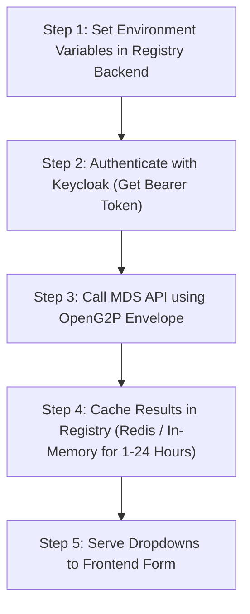

# How to Connect External Registries to Master Data Service (MDS)
**Step-by-Step Onboarding, Setup Guide & Developer Handover Checklist**

---

## 1. Overview in Simple Words

**What is Master Data Service (MDS)?**  
MDS is the central "dictionary" of the entire agricultural system. It holds all official codes for:
- Administrative Locations (Regions, Zones, Woredas)
- Crops and Seed Varieties
- Livestock Species and Breeds
- Agricultural Inputs (Fertilizers, Lime, Inoculants)

**Why do other registries need MDS?**  
Registries like the **Farmer Registry**, **Crop Sown Registry**, and **Livestock Registry** should **never** hardcode dropdown lists in their own databases. Instead, they connect to MDS to get the official, up-to-date lists so that everyone uses the exact same codes.

---

## 2. Cheat Sheet: What Details You Need to Share with Them

Copy and paste this section directly into an email or message to the external registry development team:

```text
================================================================================
MDS CONNECTION DETAILS FOR REGISTRY INTEGRATION
================================================================================
1. Backend API Base URL:
   - Develop: https://master-data.development.oanstaging.com
   - Local Docker (if testing locally): http://localhost:8044

2. Keycloak Authentication Server:
   - Keycloak URL: https://keycloak.development.oanstaging.com
   - Realm: staff
   - Client ID: admin-cli (or your assigned client: farmer-registry-staff-portal)
   - Grant Type: client_credentials (for background server-to-server) or password

3. API Protocol & Format:
   - HTTP Method: POST
   - Content-Type: application/json
   - Header Required: Authorization: Bearer <TOKEN>
   - Payload Wrapper: Standard OpenG2P Envelope (request_header + request_body)

4. Key Endpoints You Need:
   - Geolocation (Region/Zone/Woreda): POST /catalogue/get_geo_units
   - Resolve Single Location P-code:   POST /catalogue/get_geo_unit
   - Catalog Dropdown Values:          POST /catalogue/get_list_values
   - Single Code Validation:           POST /catalogue/get_list_value
   - List All Catalogs:               POST /catalogue/get_lists

5. Key Catalog Codes:
   - Crops:      CROP_CATALOG
   - Varieties:  CROP_VARIETY_CATALOG (filter by parent_code='CropName')
   - Inputs:     INPUT_CATALOG
   - Livestock:  LIVESTOCK_CATALOG
   - Breeds:     LIVESTOCK_BREED_CATALOG (filter by parent_code='SpeciesCode')
================================================================================
```

---

## 3. What the External Registry Team Needs to Setup (Step-by-Step)

Here is what the external registry developers must build in their backend:



---

### Step 1: Add Configuration Variables in their Registry Backend

They need to store these environment variables in their application config (`.env`):

```dotenv
# MDS Connection Config
MDS_API_BASE_URL=https://master-data.development.oanstaging.com
KEYCLOAK_TOKEN_URL=https://keycloak.development.oanstaging.com/realms/staff/protocol/openid-connect/token
KEYCLOAK_REALM=staff
KEYCLOAK_CLIENT_ID=admin-cli
KEYCLOAK_CLIENT_SECRET=YOUR_SECRET_HERE
SENDER_APP_MNEMONIC=farmer-registry-backend
```

---

### Step 2: Implement Token Acquisition (M2M Authentication)

Their backend must make a quick `POST` call to Keycloak to obtain a Bearer JWT token before calling MDS:

* **URL**: `POST https://keycloak.development.oanstaging.com/realms/staff/protocol/openid-connect/token`
* **Header**: `Content-Type: application/x-www-form-urlencoded`
* **Form Parameters**:
  * `grant_type`: `client_credentials` (or `password`)
  * `client_id`: `admin-cli`
  * `client_secret`: `YOUR_SECRET` (if using client secret)
  * `username` & `password`: (if using password grant)

**Simple Python Example:**
```python
import requests

def get_mds_token():
    url = "https://keycloak.development.oanstaging.com/realms/staff/protocol/openid-connect/token"
    data = {
        "grant_type": "password",
        "client_id": "admin-cli",
        "username": "moa.maker",
        "password": "YOUR_PASSWORD"
    }
    response = requests.post(url, data=data)
    response.raise_for_status()
    return response.json()["access_token"]
```

---

### Step 3: Implement the OpenG2P Envelope Builder

MDS expects requests inside a standard JSON envelope with `request_header` and `request_body`. Their backend should create a helper function like this:

**Simple Python Helper:**
```python
import uuid
from datetime import datetime, timezone

def make_mds_request(endpoint, payload, pagination={"current_page": 1, "page_size": 100}):
    token = get_mds_token()
    url = f"https://master-data.development.oanstaging.com{endpoint}"
    
    body = {
        "request_header": {
            "sender_app_mnemonic": "farmer-registry-backend",
            "sender_app_url": "https://farmer-registry.oanstaging.com",
            "request_id": str(uuid.uuid4()),
            "request_timestamp": datetime.now(timezone.utc).isoformat()
        },
        "request_body": {
            "pagination_request": pagination,
            "request_payload": payload
        }
    }
    
    headers = {
        "Content-Type": "application/json",
        "Authorization": f"Bearer {token}"
    }
    
    response = requests.post(url, json=body, headers=headers)
    response.raise_for_status()
    return response.json()
```

---

### Step 4: Call MDS for Dropdowns & Locations

Now their backend can fetch any data from MDS with one clean function call:

#### Example A: Fetch All Regions (Level 1)
```python
res = make_mds_request("/catalogue/get_geo_units", {"level_id": "l1"})
regions = res["response_body"]["response_payload"]["units"]
# Result: [{'unit_id': 'ET04', 'name': 'Oromia', 'pcode': 'ET04'}, ...]
```

#### Example B: Fetch Zones under Oromia (Level 2 Cascading)
```python
res = make_mds_request("/catalogue/get_geo_units", {"level_id": "l2", "parent_unit_id": "ET04"})
zones = res["response_body"]["response_payload"]["units"]
# Result: [{'unit_id': 'ET0401', 'name': 'Jimma', 'pcode': 'ET0401'}, ...]
```

#### Example C: Fetch All Varieties for Teff
```python
res = make_mds_request("/catalogue/get_list_values", {
    "list_code": "CROP_VARIETY_CATALOG",
    "parent_code": "Teff"
})
varieties = res["response_body"]["response_payload"]["values"]
# Result: [{'value_code': 'Quncho (DZ-Cr-387)', 'display': 'Quncho'}, ...]
```

---

### Step 5: Recommended Caching Strategy (Best Practice)

> [!TIP]
> **Do not query MDS on every single user click!**  
> Reference data (like regions, crops, fertilizers) rarely changes.  
> Registries should cache results in **Redis** or in-memory memory for **1 hour to 24 hours**.

* **Locations (Regions, Zones, Woredas)**: Cache for 24 hours.
* **Crops & Varieties**: Cache for 12 hours.
* **Fertilizers & Inputs**: Cache for 12 hours.
* **Single code validation**: Check cache first; if missing, call `POST /catalogue/get_list_value`.

---

## 4. What Questions Will the Other Registry Team Ask You? (FAQ)

Here are the exact questions their developers and architects will ask you, along with the answers you should give them:

---

### Q1: "Why do we get 401 Unauthorized or 404 Not Found when calling `/public/...`?"
**Your Answer**:  
*"Our development server has strict government privacy settings enabled (`visibility: private`). The anonymous public endpoints are hidden to protect government reference data. You must use the authenticated Core API endpoints (`POST /catalogue/...`) with your Keycloak Bearer token."*

---

### Q2: "How long does our Keycloak access token last? Do we need a new token for every request?"
**Your Answer**:  
*"Access tokens are valid for 1 hour (3,600 seconds). You do not need to generate a token for every request. Your backend should store the token in memory and only request a new one when it expires."*

---

### Q3: "What data format should we store in our registry database when a farmer selects a location or crop?"
**Your Answer**:  
*"Always store the canonical code, NOT just the English text name:*
- *For locations: Store the official P-code (e.g., `ET04` for Oromia, `ET040103` for Dedo).*
- *For crops: Store the `value_code` (e.g., `CROP_TEFF` or `1`).*
- *For varieties: Store the `value_code` (e.g., `Quncho (DZ-Cr-387)`).*
- *For fertilizers: Store the input code (e.g., `FERT-NPSB`, `FERT-UREA`).*
*This guarantees that reports across Farmer Registry, Crop Sown Registry, and LDI match 100% without spelling mistakes."*

---

### Q4: "How do we get child dropdowns to update when a parent dropdown changes?"
**Your Answer**:  
*"Use the `parent_unit_id` or `parent_code` parameter:*
- *When user chooses Region `ET04` $\rightarrow$ call `/catalogue/get_geo_units` with `level_id: 'l2', parent_unit_id: 'ET04'` to get its Zones.*
- *When user chooses Zone `ET0401` $\rightarrow$ call `/catalogue/get_geo_units` with `level_id: 'l3', parent_unit_id: 'ET0401'` to get its Woredas.*
- *When user chooses Crop `Teff` $\rightarrow$ call `/catalogue/get_list_values` with `list_code: 'CROP_VARIETY_CATALOG', parent_code: 'Teff'` to get its Varieties.*
- *When user chooses Species `BOVINE` $\rightarrow$ call `/catalogue/get_list_values` with `list_code: 'LIVESTOCK_BREED_CATALOG', parent_code: 'BOVINE'` to get Cattle Breeds."*

---

### Q5: "If we only have a Woreda P-code like `ET040103`, how do we know which Zone and Region it belongs to?"
**Your Answer**:  
*"Call `POST /catalogue/get_geo_unit` with `{"unit_id": "ET040103"}`. It immediately returns the Woreda details plus its complete ancestry array: Zone (Jimma) and Region (Oromia) in a single response."*

---

### Q6: "What happens if Master Data Service goes down or is slow?"
**Your Answer**:  
*"Because your registry caches the catalog data in Redis or local memory for 24 hours, your portal will continue to serve dropdowns and register farmers seamlessly without interruption even if MDS undergoes scheduled maintenance."*

---

### Q7: "How will we know when a new crop, seed variety, or fertilizer is added to MDS?"
**Your Answer**:  
*"MDS uses Maker-Checker versioning. When the Ministry of Agriculture approves a new version, it is published immediately. If your cache expires (e.g. after 12–24 hours), your registry automatically receives the new entries. MDS also provides official immutable releases (e.g. `2026.1`) for annual certified baselines."*

---

### Q8: "How does pagination work if a catalog has hundreds of entries?"
**Your Answer**:  
*"Inside `request_body`, include `pagination_request` with `current_page` and `page_size`:*
```json
"pagination_request": {
  "current_page": 1,
  "page_size": 100,
  "sort_by": "display"
}
```
*MDS returns `total_records`, `total_pages`, and the current records list."*

---

### Q9: "Can we search or filter items by text?"
**Your Answer**:  
*"Yes! You can pass `"search": "Wheat"` or `"search_text": "Wheat"` inside the request payload to search across names, scientific labels, and descriptions."*

---

### Q10: "Do you have Postman collections we can use to test?"
**Your Answer**:  
*"Yes. We have pre-built Postman collections and environment files ready to import:*
- *Collection: `MDS_QA_Testing_Collection.postman_collection.json`*
- *Environment: `MDS_Dev_Environment.postman_environment.json`*
- *Handbook: `MDS_Complete_API_Testing_and_QA_Demo_Guide.docx`"*

---

## 5. Summary Checklist Before Integration Meeting

When you meet with the external registry team:
- [ ] Share the Cheat Sheet in **Section 2** with URLs and credentials.
- [ ] Ensure their developers know to call `POST /catalogue/...` (not `/public/...`).
- [ ] Confirm they have valid Keycloak test credentials (`moa.maker` / `admin-cli`).
- [ ] Share the Word Guide: [`MDS_Complete_API_Testing_and_QA_Demo_Guide.docx`](file:///home/user/master-data-standalone/MDS_Complete_API_Testing_and_QA_Demo_Guide.docx).
- [ ] Share the specific registry guide:
  - [Farmer Registry Guide](file:///home/user/master-data-standalone/docs/01_FARMER_REGISTRY_MDS_INTEGRATION_GUIDE.md)
  - [Crop Sown Registry Guide](file:///home/user/master-data-standalone/docs/02_CROP_SOWN_REGISTRY_MDS_INTEGRATION_GUIDE.md)
  - [Livestock Registry Guide](file:///home/user/master-data-standalone/docs/03_LIVESTOCK_REGISTRY_MDS_INTEGRATION_GUIDE.md)
